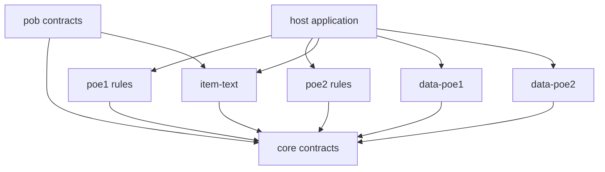

# Architecture

Exile Engine separates immutable client facts, interpretation, and calculation rules. Its public packages are portable ESM modules; Node is used for development tooling and host-side examples.

## Dependency direction

`core` does not import game packages, datasets or adapters. The host chooses the game and exact snapshot and supplies I/O. Loading a package does not eagerly load all catalogs. The data readers verify shard sizes, checksums and row identities, cache requested tables, and expose cache clearing.

## Data and identities

`SnapshotIdentity` separates the game, installed build and content snapshot ID from npm package semver. `CatalogRecord` preserves a source row and its fields. Resolvable foreign references carry table/key/row identity; excluded or dangling relationships stay explicit source references. A stable game stat ID is retained exactly, including `%`, `+` and punctuation.

`StatContribution` represents one occurrence with its source, value, scope and any conditions. Do not prematurely reduce the input to a single value per stat ID. SD description names and export filenames are presentation identities. Numeric table positions and passive graph node IDs are distinct identities scoped to the source snapshot.

## Interpretation and calculation

The SD parser retains ordered stat groups, ranges, handlers, locales and include relationships. Item parsing emits candidates and original lines. Reconciliation selects a defensible interpretation before calculation; parsing text alone does not prove that an entire item or character is supported.

Game packages normalize only the data needed for their supported mechanic. The first normalizer reads client-authored Spark resolved damage and cast-time records. The synchronous calculator applies the explicitly implemented stat operations and returns a trace. Client facts remain separate from the formula code. No suffix-based naming heuristic supplies missing semantics.

The PoB package adapts a bounded, documented PoE1 XML subset to canonical selected-skill inputs. It retains unresolved data and emits no calculable input unless the entire imported slice is supported. It never invokes PoB. XML parsing and item-line interpretation stay outside the calculation package.

PoE1 `calculateSelectedSkill` is the fresh full-recomputation reference. A selected-skill session captures immutable dataset facts and caches base, damage increase, cast-speed increase, pre-resistance hit, post-resistance hit and cast-rate nodes. Every update validates all external input, discovers the current dependency sets, and propagates dirty leaves and changed dependency sets. Reports name the derived nodes actually evaluated. Metadata/provenance changes also invalidate result assembly. Invalid updates preserve the last accepted state.

Spell added lightning is an ordered two-stat group with shared provenance. Separate cached nodes sum raw endpoints, apply the selected level's client-derived effectiveness, and add intrinsic base damage. Changed group membership invalidates those consumers; changed gem level invalidates scaled/combined damage while retaining raw sums. Effectiveness is immutable dataset data, not an XML expression or caller modifier. The intrinsic hit contract stays distinct from the selected-skill trace of raw/effective/combined ranges.

The PoE1 normalizer additionally loads the one reviewed normal Controlled Destruction support through exact gem/effect/statset/type references from the same snapshot. Support selection is typed data, never a formula or dynamic rule path. A separate `support-effects` node applies its level and enabled state; support edits retain cached base, added damage and increased totals. More spell damage applies before hit rounding; less critical chance applies only to the explicit average-critical profile, and cast-time multiplier 1 preserves Spark's active cast time. The support trace owns its raw contributions and source rows independently from the base hit trace. Unknown support mechanics fail closed.

Critical chance and multiplier have separate aggregate nodes with exact stat-ID dependency sets. A critical-effects node combines source level chance, the explicitly pinned player multiplier rule, support less-crit, noncritical hit ranges and explicit critical/ailment configuration. It computes a deterministic expected hit, without sampling or modeling ailments. The existing `hit` trace stays noncritical; critical ranges and expected means live separately. Mode-only edits invalidate critical effects and final assembly, preserving normal-hit and cast caches. Shared assembly updates the support contribution's applicability flag without recomputing its numeric facts. The full path and incremental path share the same critical arithmetic helper and validate identical bounded inputs.

Lightning resistance has its own staged dependency chain: strongest active exposure, uncapped resistance, cap/floor, penetration total and effective resistance. Exposure is explicit configured enemy state; it is not inferred from skill hits. Penetration applies after caps, so selected rules can legitimately resolve below -200%. Both normal-hit and critical-hit calculations consume the same effective value. The full path starts the isolated core calculation at resistance zero, then applies the resolved selected-skill factor; it does not bypass the isolated API's validation bounds. Trace assembly preserves all candidate/source identities, including inactive and tied exposures. A separate already-effective profile remains available to direct callers, with no new mechanics inferred from that number.

Configured shock is separate supplied enemy state with explicit integer magnitude and host uptime, independent of hit generation. A `shock-effects` node weights shocked and unshocked post-resistance expected means and consumes the normal/critical damage nodes without changing them. It has no cast-rate dependency: final assembly multiplies the weighted mean by current casts. Shock-only and scenario-source edits reuse the earlier arithmetic. Exact shock damage-taken stat identity, scenario source and externally pinned formula provenance stay distinct. Native PoB has no uptime field; the adapter requires host metadata and reference tests blend separately executed endpoints transparently.

Dependency graphs are bounded and checked before evaluation. Cyclic and feedback-dependent nodes fail with `graph.feedback-unsupported`; there is no previous-value fallback or implicit fixed-point iteration. Future feedback mechanics need a specified state model or bounded solver, convergence criteria and failure semantics before acceptance.
