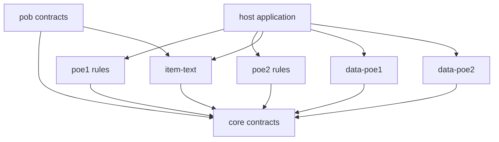

# Architecture

Exile Engine separates immutable client facts, interpretation, and calculation rules. Its public packages are portable ESM modules; Node is used for development tooling and host-side examples.

## Dependency direction

`core` does not import game packages, datasets or adapters. The host chooses the game and exact snapshot and supplies I/O. Loading a package does not eagerly load all catalogs. The data readers verify shard sizes, checksums and row identities, cache requested tables, and expose cache clearing.

## Data and identities

`SnapshotIdentity` separates the game, installed build and content snapshot ID from npm package semver. `CatalogRecord` preserves a source row and its fields. Resolvable foreign references carry table/key/row identity; excluded or dangling relationships stay explicit source references. A stable game stat ID is retained exactly, including `%`, `+` and punctuation.

`StatContribution` represents one occurrence with its source, value, scope and any conditions. Do not prematurely reduce the input to a single value per stat ID. SD description names and export filenames are presentation identities. Numeric table positions and passive graph node IDs are distinct identities scoped to the source snapshot.

## Interpretation and calculation

The SD parser retains ordered stat groups, ranges, handlers, locales and include relationships. Item parsing emits candidates and original lines. Reconciliation selects a defensible interpretation before calculation; parsing text alone does not prove that an entire item or character is supported.

Game packages normalize only the data needed for their supported mechanic. The first normalizer reads client-authored Spark resolved damage and cast-time records. The synchronous calculator applies the explicitly implemented stat operations and returns a trace. Client facts remain separate from the formula code. No suffix-based naming heuristic supplies missing semantics.

The PoB package currently defines compatibility contracts and an explicit capability status. A future XML adapter will consume data and produce canonical inputs with unresolved fields; it will never invoke PoB.
